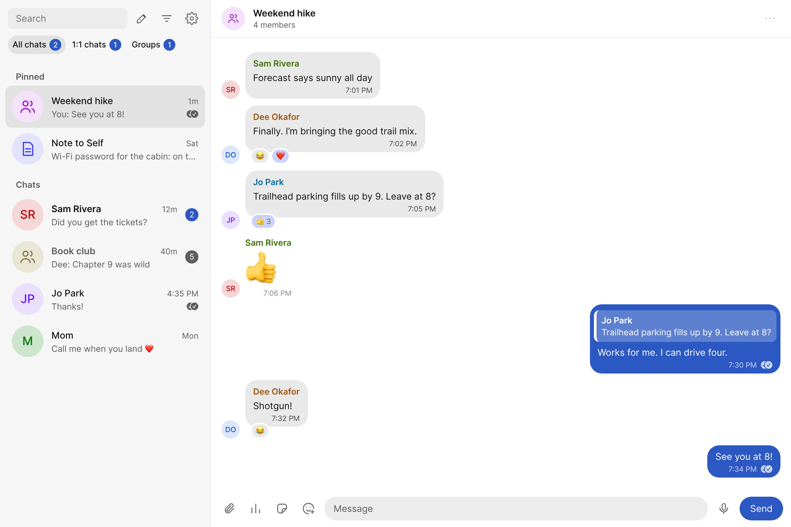
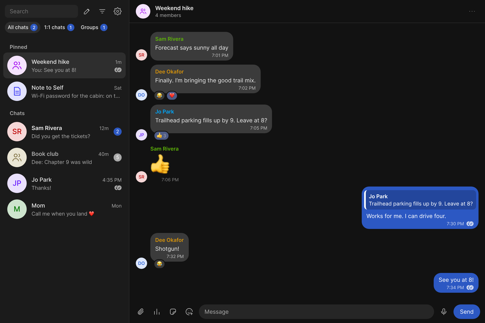

# Backchannel

_Signal for people who actually have friends._

**Your Signal chats in a browser tab.** Backchannel runs Signal Desktop on
your own server and gives you a fast web page for it, so you can use
Signal in Rambox, Ferdium, or any browser, on any computer, without
installing Signal there.



<details>
<summary>Dark mode</summary>



</details>

Backchannel is not made, endorsed or supported by Signal Messenger.
"Signal" is their trademark and is used here only to say what this works
with.

## What you get

It's linked to your phone as one more Signal device, like Signal Desktop.
Messages you send reach your other devices, read state syncs both ways,
and mute and archive settings come across. The page does what Signal
Desktop does:

- **Chats:** pinned chats, All / 1:1 / Groups tabs, an unread filter,
  archived chats, message requests, drafts, delivery checkmarks, and
  search across all your messages.
- **Messages:** reactions (and who reacted), replies that jump to the
  original, edit and delete, polls, stickers, link previews, disappearing
  messages, typing indicators, an unread line where you left off, and
  each chat's photos, files, audio and links in All media.
- **Writing:** @mentions, bold, italic, strikethrough, monospace and
  spoilers, the full emoji picker with skin tones, pasting and dropping
  images, files, voice notes, and scheduled messages.
- **Groups:** start chats and groups, add and remove members, admins, the
  group link, name, photo and permissions. Click someone's photo for their
  contact card, or reply to them privately with the group message quoted.
- **Settings:** your profile, notifications, privacy, the blocked list
  and themes.

The full list, with what's still missing, is
[PARITY.md](https://github.com/mikesimone/Signal-Desktop/blob/main/contrib/backchannel/helper/PARITY.md).

## Beyond Signal Desktop

A running list of things Signal Desktop doesn't do, or limits, that
Backchannel does. Each new one is added here when it ships; items newer
than the latest release are marked _(next release)_.

- **Any browser tab.** Signal runs on your server, always online, and you
  use it from a tab in Rambox, Ferdium or any browser. No Signal Desktop
  window on your PC.
- **Notifications from the tab.** While the page is open, notifications
  come from it, not from a second Signal window.
- **Forward to any number of chats.** Signal forwards to at most five;
  Backchannel lists every chat, most recent first, with no limit.
- **One poll to many chats.** Signal can't forward a poll; Backchannel
  sends each chat its own copy.
- **Reply privately** to someone in a group: their message is quoted in
  your 1:1 chat, and the two are linked both ways on the page. Signal
  Desktop has no such option.
- **Sticker replies.** Signal has them built in but switched off;
  Backchannel sends a sticker as a reply. Recipients see the quote once
  their Signal app shows sticker replies.
- **Bold italic in one step**, from the format menu or bar. Signal needs
  two.
- **Scheduled messages.** Signal Desktop has none. Backchannel sends them
  from your server at the time you pick, even with your PC off.
- **Edit and tag when forwarding.** Signal lets you edit a forward's text;
  Backchannel also lets you @mention people. Each chat gets a real tag
  where that person is in the group, and plain "@Name" text elsewhere.
- **Markdown shortcuts and SMS-ready copies.** Type \*bold\*,
  \_italic\_, \_\*bold italic\*\_, \~strikethrough\~ or \`monospace\` and the
  style applies as you type (Backspace right after undoes it), or as you
  paste text that has them. Copying
  styled text puts Unicode bold, italic and strikethrough letters on the
  clipboard, so the styles survive a paste into an SMS or anywhere else,
  and pasting such text into Backchannel turns it back into Signal's styles.

## How it stays private

- **Signal keeps every key.** The page talks to Signal Desktop through a
  local API that Signal itself guards: nothing can use it until you allow
  that app inside Signal, and only for what you allowed.
- **Nothing leaves your server** except Signal's own traffic. There's no
  account to sign up for and no third-party service.
- **The page is behind a secret address** that only you have, and the
  container only listens on the server's own loopback. You put your own
  HTTPS reverse proxy in front of it.
- **You build it yourself** from public source. No prebuilt image is
  published.

The full security design:
[external-client threat model](https://github.com/mikesimone/Signal-Desktop/blob/main/docs/external-client-threat-model.md).

## Quick start

You need:

- An x86-64 Linux host with Docker and Compose. ARM hosts, such as a
  Raspberry Pi or an Apple Silicon Mac, are untested.
- Several GB of free disk for the build.
- Your phone with Signal on it.

1. Get the code and make a data folder:

   ```sh
   git clone https://github.com/mikesimone/backchannel.git
   cd backchannel
   cp .env.example .env
   sudo mkdir -p /var/lib/backchannel
   sudo chown 1000:1000 /var/lib/backchannel
   ```

   Edit `.env` if your user ID (`id -u`) isn't 1000 or you want the data
   somewhere else. The data folder holds your Signal profile and keys, so
   keep it private and back it up.

2. Build and start it: `docker compose up -d --build`. The first build
   compiles Signal Desktop from source and takes a while (about 20 minutes
   on a small server).

3. Link it to your phone:
   - `docker compose exec backchannel screen.sh qr` prints the link QR code
     in your terminal.
   - In Signal on your phone, go to Settings > Linked devices > Link new
     device and scan it.
   - Signal then asks for a device name. Answer with
     `docker compose exec backchannel screen.sh type 'My server'`, then
     `... screen.sh key Return`.

4. Approve the page. Signal shows a dialog asking to allow "Backchannel".
   Run `screen.sh shot` to save `screen.png` in the data folder and see
   where the button is, then `screen.sh click X Y`. For a live view of the
   screen, see [Seeing Signal's screen](#seeing-signals-screen) below.

5. Open the page. `docker compose exec backchannel screen.sh url` prints
   its address, with a secret token in it. Anyone with that address can
   read and send your messages, so treat it like a password.

### Reaching the page from other machines

Put a reverse proxy with HTTPS in front of port 8083 and set
`BACKCHANNEL_ORIGIN` in `.env` to its address. Let the proxy pass large
uploads, or bigger photos fail with HTTP 413. In nginx, add
`client_max_body_size 100m;` to that server block.

**In Rambox or Ferdium:** add a custom app or service, paste the address,
and turn on notifications. In Rambox, also turn on "Display in tab" for
the unread badge.

### Seeing Signal's screen

You only need this for linking and approval. Run
`docker compose exec backchannel screen.sh vnc`. Then, from your own
machine, run `ssh -L 5901:127.0.0.1:5901 yourserver` and open a VNC
viewer on `localhost:5901`.

### On Windows (Docker Desktop)

This is untested so far, but nothing in it is specific to Linux hosts.
Docker Desktop runs the same Linux container inside WSL 2.

1. Install Docker Desktop with the WSL 2 backend (its default), and a WSL
   distribution such as Ubuntu (`wsl --install -d Ubuntu` in PowerShell).
   In Docker Desktop, go to Settings > Resources > WSL integration and turn
   it on for that distribution.
2. Do the quick start inside the WSL shell (`wsl`), not in PowerShell.
   Keep both the clone and the data folder in the WSL file system, for
   example `~/backchannel` and `~/backchannel-data`, and set `.env` to
   match:
   - `BACKCHANNEL_DATA=/home/you/backchannel-data`
   - `BACKCHANNEL_UID` set to the output of `id -u`

   A folder on `C:` (`/mnt/c/...`) is much slower for the build, and it
   can't keep the Unix permissions Signal's profile needs.

3. Docker Desktop forwards the ports to Windows. On that PC, the address
   from `screen.sh url` opens as is in any browser or in Rambox.

Give WSL enough memory for the build. If the build gets killed, set
`memory=8GB` or more in `.wslconfig`.

It's only online while that PC is awake and Docker Desktop is running.
Messages still reach your phone, and the page catches up when the PC comes
back, as Signal Desktop does.

## Updating

```sh
git pull
docker compose up -d --build
```

Each release here pins a tested version of the fork. Your link and
approval live in the data folder, so rebuilding keeps them. Update at
least every couple of months: Signal Desktop builds stop working about 90
days after they're built.

## Removing it

1. On your phone, go to Settings > Linked devices and unlink the device.
2. Run `docker compose down`.
3. Delete the data folder. It holds the Signal profile and keys.
4. Optionally, run `docker image rm backchannel`.

## Moving from the fork's contrib/backchannel

If you set Backchannel up from `contrib/backchannel` in the Signal-Desktop
fork, you can move without linking again:

1. Run `docker compose down` there.
2. Copy its `.env` here. The older names `SIGNAL_UID`, `SIGNAL_DATA` and
   `RAMBOX_ORIGIN` must be renamed to the `BACKCHANNEL_` ones.
3. Run `docker compose up -d --build` here.

Don't run both at once, because they'd share one Signal profile.

## Where the code lives

This repository is the front door: setup, releases and issues. The code is
in the [Signal-Desktop fork](https://github.com/mikesimone/Signal-Desktop),
because most features change both Signal Desktop's bridge and the page
together:

- The bridge is in `ts/externalClient`.
- The page and helper are in `contrib/backchannel`.
- The fork merges every Signal Desktop release.

The helper can also run next to Signal Desktop on your own PC, without
Docker. See the
[helper README](https://github.com/mikesimone/Signal-Desktop/tree/main/contrib/backchannel/helper).

Found a bug or something Signal Desktop does that the page doesn't?
[Open an issue here](https://github.com/mikesimone/backchannel/issues).

## Tip jar

If Backchannel is useful to you, you can leave a tip at
[ko-fi.com/gcbapps](https://ko-fi.com/gcbapps).

## License

AGPL-3.0, like Signal Desktop. See [LICENSE](LICENSE).
